  

<h1 align="center">
  Fernando Santos de Siqueira
  
</h1>

  

  
  
  
  

---

### 👋 Sobre mim

Sou **desenvolvedor fullstack** de **São Paulo (SP)**, com foco em **análise de dados para transmissões de e-Sports**.

Trabalho em uma empresa de **broadcast de games**, onde desenvolvo **APIs para coleta e tratamento de dados dos jogos** usados em transmissões ao vivo, além de **ferramentas, integrações e overlays** que dão suporte à operação e à exibição das informações durante as partidas.

- 🎮 **Broadcast de games** e **e-Sports** (PUBG, Free Fire, Crossfire e outros)
- 🧠 **APIs**, ferramentas internas e integrações para a produção ao vivo
- 📡 Coleta, tratamento e exibição de **dados em tempo real**
- 🖥️ **Overlays** para OBS / vMix e soluções visuais para a operação
- 📚 Aprendizado contínuo e evolução constante na área de tecnologia

---

### 🚀 Linguagens e Tecnologias

  
   
  

---

### 🛠️ Projetos em destaque

<table>
  <tr>
    <td width="50%" valign="top">
      <h4>🗄️ WHIDO DB</h4>
      
Plataforma para gerenciar dados de transmissões de jogos competitivos: torneios, times, jogadores e estatísticas de partidas para a produção ao vivo.

      
      
      
      
    </td>
    <td width="50%" valign="top">
      <h4>📺 PUBG Match Monitor</h4>
      
Monitor de partidas de PUBG para campeonatos: API com detectores em tempo real (first blood, marcos de kills e dano) e app desktop que consome a API.

      
      
      
    </td>
  </tr>
  <tr>
    <td width="50%" valign="top">
      <h4>🔎 Crossfire Scoreboard OCR</h4>
      
Ferramenta desktop que lê automaticamente os placares do Crossfire via OCR e exporta tudo direto para o Google Sheets.

      
      
      
    </td>
    <td width="50%" valign="top">
      <h4>🏆 Overlays de transmissão</h4>
      
Torres de classificação ao vivo para FFWS e PUBG: ranking por eliminações, HP dos jogadores e modo especial para os 4 finalistas, usados no OBS.

      
      
      
      
    </td>
  </tr>
  <tr>
    <td width="50%" valign="top">
      <h4>💾 Save Editor</h4>
      
Editor de saves com interface gráfica que detecta a engine sozinho (RPG Maker, Ren'Py, Godot) e mostra as variáveis editáveis em cards.

      
      
    </td>
    <td width="50%" valign="top">
      <h4><a href="https://github.com/Fernando-dev-ssd/History-Cleaner">🧹 History Cleaner</a></h4>
      
Extensão para o Chrome que pesquisa e apaga o histórico de navegação com precisão, sem precisar apagar cookies nem sair dos sites.

      
      
    </td>
  </tr>
</table>

---

### 📊 Atividade

  
   
  

  <picture>
    <source media="(prefers-color-scheme: dark)" srcset="https://raw.githubusercontent.com/Fernando-dev-ssd/Fernando-dev-ssd/output/github-contribution-grid-snake-dark.svg"/>
    <source media="(prefers-color-scheme: light)" srcset="https://raw.githubusercontent.com/Fernando-dev-ssd/Fernando-dev-ssd/output/github-contribution-grid-snake.svg"/>
    
  </picture>

---

  

